# Design Document

## Overview

The To-Do Life Dashboard is a zero-dependency, single-page web application built exclusively with HTML, CSS, and Vanilla JavaScript. The entire app ships as three files: `index.html`, `css/style.css`, and `js/app.js`. All state is persisted in the browser's `localStorage`; there is no backend, no build step, and no external network request at runtime.

The page renders four independent widgets in a responsive grid:

| Widget | Primary responsibility |
|---|---|
| **Greeting** | Live 24-hour clock, full date string, time-of-day greeting |
| **Focus Timer** | 25-minute Pomodoro countdown with Idle / Running / Paused states |
| **Task List** | Add / edit / complete / delete tasks persisted under `"tasks"` key |
| **Quick Links** | Save up to 20 labelled URL shortcuts persisted under `"links"` key |

Design goals:
- All widgets visible and interactive within 500 ms of page load.
- Full functionality from the filesystem (`file://`) or any static host.
- Compatible with the latest releases of Chrome, Firefox, Edge, and Safari.
- Responsive between 320 px and 1920 px viewport widths.

---

## Architecture

### File Structure

```
index.html          ← single HTML page, declares all widget markup shells
css/
  style.css         ← all styles; custom properties for theming
js/
  app.js            ← all JavaScript; IIFE-wrapped modules per widget
```

### Execution Model

`app.js` is loaded with `<script defer src="js/app.js">` so it executes after the DOM is parsed. The file is structured as one Immediately Invoked Function Expression (IIFE) that calls each widget's `init()` function in sequence:

```
(function () {
  GreetingWidget.init();
  FocusTimer.init();
  TaskList.init();
  QuickLinks.init();
})();
```

Each widget is a plain object literal (module pattern) scoped inside `app.js` — no ES modules, no classes — to maximise browser compatibility and avoid the need for a local HTTP server when opening from `file://`.

### Dependency Graph

```
index.html
 └── js/app.js
      ├── StorageService      (shared localStorage wrapper)
      ├── GreetingWidget      (reads Date; no storage)
      ├── FocusTimer          (manages timer state; no storage)
      ├── TaskList            (read/write StorageService["tasks"])
      └── QuickLinks          (read/write StorageService["links"])
```

`StorageService` is the only shared object; widgets do not call each other.

---

## Components and Interfaces

### StorageService

Wraps `localStorage` with try/catch on every read and write, returning `null` or `false` on failure rather than throwing.

```
StorageService = {
  get(key)        → parsed JSON value | null,
  set(key, value) → true | false (false = write failed),
}
```

### GreetingWidget

```
GreetingWidget = {
  init()                     → void   // queries DOM, starts interval
  _tick()                    → void   // called every 1 000 ms
  _formatTime(date)          → string // "HH:MM:SS"
  _formatDate(date)          → string // "Weekday, Month DD, YYYY"
  _greeting(hour)            → string // "Good Morning" | "Good Afternoon" | "Good Evening"
  _handleClockError()        → void   // renders unavailability placeholder
}
```

DOM nodes written to:
- `#greeting-text` — greeting string
- `#clock-time`    — HH:MM:SS
- `#clock-date`    — full date string

### FocusTimer

```
FocusTimer = {
  _state: "idle" | "running" | "paused",
  _remaining: number,          // seconds remaining
  _intervalId: number | null,

  init()           → void
  _start()         → void
  _stop()          → void
  _reset()         → void
  _tick()          → void      // decrements _remaining, checks 00:00
  _render()        → void      // updates display and button disabled states
  _formatMM_SS(s)  → string    // 1500 → "25:00"
  _playSignal()    → void      // Web Audio API beep 1–3 s
}
```

DOM nodes:
- `#timer-display`   — "MM:SS"
- `#btn-start`       — Start
- `#btn-stop`        — Stop
- `#btn-reset`       — Reset

### TaskList

```
TaskList = {
  _tasks: Task[],

  init()                       → void
  _load()                      → void   // reads StorageService, renders all
  _save()                      → void   // writes _tasks to StorageService
  _add(title)                  → void
  _delete(id)                  → void
  _toggleComplete(id)          → void
  _startEdit(id)               → void
  _confirmEdit(id, newTitle)   → void
  _cancelEdit(id)              → void
  _render()                    → void   // full re-render of task list
  _renderItem(task)            → HTMLElement
  _validate(title)             → string | null  // null = valid; string = error message
  _showStorageError(msg)       → void
}
```

DOM nodes:
- `#task-input`      — text input
- `#task-submit`     — add button
- `#task-error`      — inline validation message
- `#task-list`       — `<ul>` container

### QuickLinks

```
QuickLinks = {
  _links: Link[],

  init()                   → void
  _load()                  → void
  _save()                  → void
  _add(label, url)         → void
  _remove(id)              → void
  _render()                → void
  _renderLink(link)        → HTMLElement
  _validate(label, url)    → string | null
}
```

DOM nodes:
- `#link-label`      — label input
- `#link-url`        — URL input
- `#link-submit`     — add button
- `#link-error`      — inline validation message
- `#links-list`      — container

---

## Data Models

### Task

```json
{
  "id":        "string (crypto.randomUUID() or Date.now().toString())",
  "title":     "string (1–200 chars, trimmed)",
  "complete":  "boolean"
}
```

### Link

```json
{
  "id":    "string",
  "label": "string (1–50 chars, trimmed)",
  "url":   "string (1–2048 chars; must start with http:// or https://)"
}
```

### localStorage Schema

| Key | Value | Written by |
|---|---|---|
| `"tasks"` | JSON array of Task objects | TaskList |
| `"links"` | JSON array of Link objects | QuickLinks |

Both keys store well-formed JSON arrays. An absent key is treated as an empty array; a malformed value is discarded and replaced with `[]`.

### ID Generation

`crypto.randomUUID()` is used when available (all modern browsers). The fallback is `Date.now().toString() + Math.random().toString(36).slice(2)`, which is collision-resistant for single-user, single-device use.

---

## Focus Timer State Machine

```mermaid
stateDiagram-v2
    [*] --> Idle : page load

    Idle --> Running : user clicks Start\n(_remaining = 1500)
    Running --> Paused : user clicks Stop\n(retains _remaining)
    Paused --> Running : user clicks Start\n(resumes from _remaining)
    Running --> Idle : user clicks Reset\n(_remaining = 1500)
    Paused --> Idle : user clicks Reset\n(_remaining = 1500)
    Idle --> Idle : user clicks Reset\n(no-op; display stays 25:00)
    Running --> Idle : _remaining reaches 0\n(plays signal, _remaining = 1500)

    note right of Idle
        Start enabled
        Stop  disabled
        Reset enabled
    end note

    note right of Running
        Start disabled
        Stop  enabled
        Reset enabled
    end note

    note right of Paused
        Start enabled
        Stop  disabled
        Reset enabled
    end note
```



**Transition table**

| Current state | Event | Next state | Side effects |
|---|---|---|---|
| Idle | Start clicked | Running | set `_remaining = 1500`, start interval |
| Running | Stop clicked | Paused | clear interval |
| Paused | Start clicked | Running | start interval (keep `_remaining`) |
| Any | Reset clicked | Idle | clear interval, set `_remaining = 1500` |
| Running | `_remaining === 0` | Idle | clear interval, play signal, set `_remaining = 1500` |

---

## CSS Architecture

All styles live in `css/style.css`. The file is organised in four layers:

### 1. Custom Properties (`:root`)

```css
:root {
  /* Colour palette */
  --color-bg:         #0f0f13;
  --color-surface:    #1a1a24;
  --color-border:     #2e2e42;
  --color-accent:     #7c6af5;
  --color-text:       #e8e8f0;
  --color-muted:      #8888a8;
  --color-success:    #4caf82;
  --color-danger:     #e05a5a;
  --color-warning:    #f0a040;

  /* Typography */
  --font-family:      system-ui, -apple-system, sans-serif;
  --font-size-base:   16px;
  --font-size-sm:     14px;
  --font-size-lg:     20px;
  --font-size-xl:     32px;

  /* Spacing */
  --space-xs:   4px;
  --space-sm:   8px;
  --space-md:  16px;
  --space-lg:  24px;
  --space-xl:  40px;

  /* Radius / shadow */
  --radius-sm:  6px;
  --radius-md: 12px;
  --shadow-card: 0 2px 12px rgba(0,0,0,0.4);
}
```

### 2. Reset and Base

Minimal reset (`box-sizing: border-box`, `margin: 0`, `padding: 0`), `body` background and font set from custom properties. All interactive elements meet WCAG 2.1 AA colour-contrast requirements (minimum 4.5:1 for normal text).

### 3. Layout

```css
/* Page */
.dashboard          { display: grid; gap: var(--space-lg); padding: var(--space-lg); }

/* Two-column grid: collapses to single column below 640 px */
@media (min-width: 640px) {
  .dashboard        { grid-template-columns: 1fr 1fr; }
}

/* Greeting spans full width */
.widget--greeting   { grid-column: 1 / -1; }
```

### 4. Component Styles

Each widget has a `.widget` base class (card background, border, border-radius, shadow) and a modifier class:

- `.widget--greeting`
- `.widget--timer`
- `.widget--tasks`
- `.widget--links`

Buttons use a `.btn` base class with `.btn--primary`, `.btn--ghost`, `.btn--danger` variants. `button:disabled` has `opacity: 0.4; cursor: not-allowed`.

Completed tasks use `.task--complete .task__title { text-decoration: line-through; color: var(--color-muted); }`.

---

## Correctness Properties

*A property is a characteristic or behavior that should hold true across all valid executions of a system — essentially, a formal statement about what the system should do. Properties serve as the bridge between human-readable specifications and machine-verifiable correctness guarantees.*

### Property 1: Greeting text is determined solely by the hour

*For any* integer hour in [0, 23], `_greeting(hour)` returns "Good Morning" for hours 5–11, "Good Afternoon" for hours 12–17, and "Good Evening" for all other hours, with no overlap or gap.

**Validates: Requirements 1.3, 1.4, 1.5**

### Property 2: Clock time format correctness

*For any* valid `Date` object, `_formatTime(date)` returns a string that matches the pattern `HH:MM:SS` (two digits each, colon-separated, 24-hour values in [00, 23], [00, 59], [00, 59]).

**Validates: Requirements 1.1**

### Property 3: Date string format correctness

*For any* valid `Date` object, `_formatDate(date)` returns a string of the form `"<FullWeekday>, <FullMonth> <DD>, <YYYY>"` where `<FullWeekday>` is a valid English weekday name, `<FullMonth>` is a valid English month name, `<DD>` is a 1-or-2-digit day, and `<YYYY>` is a 4-digit year.

**Validates: Requirements 1.2**

### Property 4: Task addition round-trip

*For any* non-empty, non-whitespace-only string of at most 200 characters, adding it as a task title and then reading back the task array from `StorageService.get("tasks")` will yield an array containing an entry with that exact trimmed title and `complete: false`.

**Validates: Requirements 3.1, 3.3**

### Property 5: Whitespace-only task titles are always rejected

*For any* string composed entirely of whitespace characters (spaces, tabs, newlines), `_validate(title)` returns a non-null error message and the task array remains unchanged.

**Validates: Requirements 3.2**

### Property 6: Task toggle is an involution

*For any* task in any completion state, toggling its `complete` flag twice returns it to the original state, and both intermediate states are written to `localStorage`.

**Validates: Requirements 3.5, 3.6**

### Property 7: Edit confirm round-trip

*For any* task and any valid new title (non-empty, non-whitespace, ≤ 200 chars), after `_confirmEdit(id, newTitle)` the task's title equals `newTitle.trim()` and `StorageService.get("tasks")` reflects the same value.

**Validates: Requirements 3.8**

### Property 8: Link validation covers all invalid inputs

*For any* combination of label and URL inputs, `_validate(label, url)` returns a non-null error message if and only if at least one of these conditions holds: label is empty, URL is empty, or URL does not start with `"http://"` or `"https://"`.

**Validates: Requirements 4.2, 4.3**

### Property 9: Link addition round-trip

*For any* valid label (1–50 chars) and URL (1–2048 chars, http/https prefix), adding a link and then reading `StorageService.get("links")` yields an array containing an entry with that exact trimmed label and URL.

**Validates: Requirements 4.1, 4.5**

### Property 10: Link count cap enforcement

*For any* state where the link array contains 20 entries, calling `_add(label, url)` leaves the array length unchanged at 20 and returns a validation error.

**Validates: Requirements 4.4**

### Property 11: Focus Timer Idle/Reset invariant

*For any* timer state (Idle, Running, or Paused), activating Reset always transitions to Idle with `_remaining === 1500` and the display showing "25:00".

**Validates: Requirements 2.6**

### Property 12: Focus Timer countdown monotonicity

*For any* sequence of Start and Stop events that does not include Reset or reaching 00:00, `_remaining` is strictly non-increasing over time.

**Validates: Requirements 2.2, 2.3, 2.4, 2.5**

---

## Error Handling

### localStorage Unavailability

`StorageService.get()` and `StorageService.set()` wrap every call in `try/catch`. When `set()` fails (quota exceeded, `localStorage` blocked in private browsing, etc.) it returns `false`. Both `TaskList._save()` and `QuickLinks._save()` check the return value and call `_showStorageError()` with a user-visible message if `false` is returned. The in-memory array is kept intact so the user can continue working in the session.

When `get()` fails or returns a string that is not valid JSON, the widget falls back to an empty array and logs a `console.warn`.

### Clock Unavailability

`GreetingWidget._tick()` wraps `new Date()` in a try/catch. If the call throws or returns an `Invalid Date`, `_handleClockError()` replaces the clock, date, and greeting DOM nodes with the text "Time unavailable".

### Invalid localStorage Data

If `JSON.parse` of a stored value throws, the widget discards the stored value, writes an empty array back to `localStorage`, and renders an empty list. This prevents a corrupted entry from permanently breaking the widget.

### Edit Cancellation / Whitespace Confirm

If the user confirms an edit with an empty or whitespace-only value, `_confirmEdit` discards the new value, restores the original title in the DOM, and does not call `_save()`. No error message is shown; the silent discard matches the specified behaviour (Requirement 3.9).

### Focus Timer Drift

`setInterval` is not perfectly accurate. The timer uses wall-clock drift correction on each tick: it compares `Date.now()` to the timestamp recorded when the interval started and adjusts `_remaining` accordingly, ensuring the displayed time stays within ±1 s of real elapsed time.

### Audio Signal Fallback

`_playSignal()` creates a short beep via the Web Audio API. If `AudioContext` is not available (very old browser or the browser blocks audio), the method silently swallows the error — the timer still resets correctly, just without audio.

### Accessibility

- All interactive elements (`<button>`, `<input>`) have visible focus rings (`:focus-visible` outline with `--color-accent`).
- `<button disabled>` elements use `aria-disabled="true"` as well, for screen reader compatibility.
- The timer display uses `role="timer"` and `aria-live="off"` (live updates would be too noisy; the final signal serves as the alert). When the timer completes, an `aria-live="assertive"` region announces "Focus session complete."
- Task list items include an `aria-label` on each action button: "Complete task: <title>", "Edit task: <title>", "Delete task: <title>".
- Link buttons include `aria-label="Open <label> in new tab"`.
- Colour contrast for all text meets WCAG 2.1 AA (4.5:1 minimum). The muted colour `#8888a8` on `#1a1a24` achieves 4.6:1.
- The dashboard layout does not rely on colour alone to convey state (completed tasks also use strikethrough; disabled buttons also change opacity).

---

## Testing Strategy

### Unit Tests (example-based)

Each pure helper function is tested with concrete examples:

| Function | Key examples |
|---|---|
| `_greeting(hour)` | 0 → "Good Evening", 5 → "Good Morning", 11 → "Good Morning", 12 → "Good Afternoon", 17 → "Good Afternoon", 18 → "Good Evening", 23 → "Good Evening" |
| `_formatTime(date)` | midnight → "00:00:00", noon → "12:00:00", 23:59:59 → "23:59:59" |
| `_formatDate(date)` | a known Monday date → "Monday, November 19, 2026" |
| `TaskList._validate` | empty string → error, "   " → error, "Buy milk" → null |
| `QuickLinks._validate` | empty label → error, "ftp://x" → scheme error, valid → null |
| `FocusTimer._formatMM_SS` | 1500 → "25:00", 0 → "00:00", 65 → "01:05" |

### Property-Based Tests

The property tests use **fast-check** (browser-compatible UMD build, no bundler required). Each test runs a minimum of 100 iterations.

**Tag format: `Feature: todo-life-dashboard, Property N: <property_text>`**

| Property | Generator sketch |
|---|---|
| P1 – Greeting coverage | `fc.integer({min:0, max:23})` |
| P2 – Clock format | `fc.date()` filtered to valid dates |
| P3 – Date format | `fc.date()` filtered to valid dates |
| P4 – Task add round-trip | `fc.string({minLength:1, maxLength:200}).filter(s => s.trim().length > 0)` |
| P5 – Whitespace rejection | `fc.stringOf(fc.constantFrom(' ','\t','\n'), {minLength:1})` |
| P6 – Toggle involution | `fc.boolean()` for initial state + any valid Task |
| P7 – Edit round-trip | valid task + valid new title string |
| P8 – Link validation coverage | `fc.tuple(fc.string(), fc.string())` covering all invalid combos |
| P9 – Link add round-trip | valid label + valid URL arbitraries |
| P10 – Link cap | link array of exactly 20 + any valid new link |
| P11 – Reset invariant | `fc.constantFrom("idle","running","paused")` as starting state |
| P12 – Countdown monotonicity | sequence of Start/Stop events without Reset |

### Integration / Smoke Tests

Manual smoke-test checklist (run once per browser):

1. Open `index.html` from `file://` — all four widgets render within 500 ms.
2. Clock ticks every second; greeting changes automatically at the hour boundary.
3. Full Pomodoro cycle: Start → Stop → Start → Reset; button disabled states are correct at each step.
4. Add 5 tasks, reload page — tasks persist. Edit one, delete one, toggle two — all persist on reload.
5. Add 20 links — 21st is rejected. Remove one — a new one can be added.
6. Resize from 320 px to 1920 px — layout remains usable at all widths.
7. Open DevTools → Application → LocalStorage → delete `"tasks"` → reload — Task List renders empty list, no error.
8. Simulate storage failure by stubbing `localStorage.setItem` to throw — storage error message appears; in-memory list is intact.
